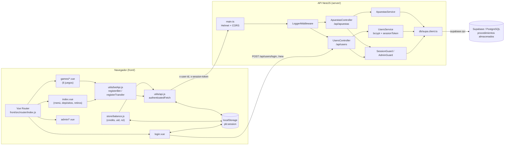
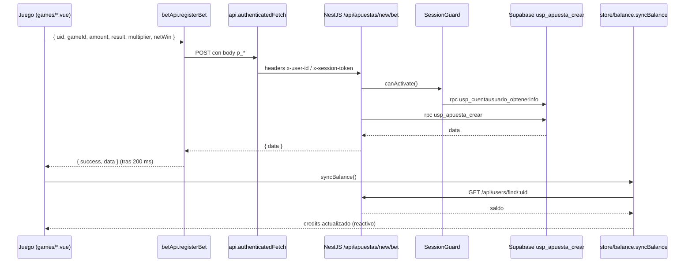

# 1. Visión general

**PascualBet** es una plataforma de apuestas y juegos de casino en línea. Permite a los usuarios registrarse, iniciar sesión, depositar y retirar créditos, y jugar seis juegos de casino (Blackjack, Ruleta, Tragamonedas, Plinko, Mines y Rocket). Cada jugada se registra en la base de datos y el saldo del usuario se sincroniza en tiempo real.

Páginas relacionadas: [Primeros pasos](01.1-getting-started.md) · [Frontend](02-frontend.md) · [Juegos](03-juegos.md) · [Backend](04-backend.md)

## Stack tecnológico

| Capa | Tecnología | Dónde |
|------|-----------|-------|
| Frontend | Vue 3 (Options API y Composition API), Vue Router 4 | `front/src/` |
| Build | Vite 7 + `@vitejs/plugin-vue` | `front/vite.config.js` |
| Estilos | Tailwind CSS 3 + CSS propio | `front/tailwind.config.js`, `front/css/globals.css`, `front/css/login.css` |
| Audio | Tone.js (síntesis) y archivos MP3 | juegos en `front/src/components/games/`, `front/public/Sounds/` |
| Gráficos | HTML5 Canvas (Ruleta, Tragamonedas, Rocket) y SVG/DOM (Plinko, Mines, Blackjack) | `front/src/components/games/` |
| Backend | NestJS 11 (Node.js, TypeScript) | `server/src/` |
| Seguridad backend | Helmet, CORS, bcryptjs, tokens de sesión con `crypto` | `server/src/main.ts`, `server/src/users/users.service.ts`, `server/src/auth/` |
| Base de datos | Supabase (PostgreSQL) accedido mediante procedimientos almacenados (RPC) | `server/src/db/supa.client.ts` |

> **Nota sobre autenticación:** aunque el `README.md` menciona "Supabase como base de datos y auth", el código **no usa Supabase Auth**. La autenticación es propia: las contraseñas se cifran con bcrypt en el servidor, los hashes se guardan en Supabase y, al iniciar sesión, el backend genera un `sessionToken` con el módulo `crypto` de Node.js (ver [Backend](04-backend.md#autenticación-y-sesiones)).

## Arquitectura



### Flujo típico de una apuesta



### Despliegue

El frontend llama a la API desplegada en `https://pascualbet-cvr6.vercel.app` (URL fija en `front/src/utils/betApi.js`, `front/src/store/balance.js` y `front/src/components/login.vue`). No existe una variable de entorno en el frontend para cambiar la URL base; para apuntar a un backend local hay que editar esas rutas (ver [Primeros pasos](01.1-getting-started.md#apuntar-el-frontend-a-un-backend-local)).

## Layout del repositorio

```text
pascualbet/
├── README.md                     # Descripción general del proyecto
├── IMPLEMENTACION_COMPLETA.md    # Sistema de registro de apuestas (6/6 juegos)
├── RESUMEN_IMPLEMENTACION.md     # Resumen de cambios por juego
├── SEGURIDAD_IMPLEMENTADA.md     # Tokens de sesión y guards
├── PETICIONES_ORGANIZADAS.md     # registerBet / registerTransfer
├── GUIA_REGISTRO_APUESTAS.md     # Guía de uso de registerBet
├── EJEMPLO_ROCKET.md             # Ejemplo paso a paso con Rocket
├── docs/wiki/                    # Esta wiki
├── front/                        # Aplicación Vue 3 + Vite
│   ├── index.html                # Punto de entrada HTML (monta #app)
│   ├── vite.config.js
│   ├── tailwind.config.js
│   ├── css/
│   │   ├── globals.css           # Variables de tema, Tailwind, estilos globales
│   │   └── login.css             # Estilos de la pantalla de login/registro
│   ├── public/                   # Assets estáticos servidos tal cual
│   │   ├── img/                  # Logo, fondo y portadas de juegos
│   │   ├── Sounds/               # Efectos MP3 (ruleta, jackpot)
│   │   └── animaciones/          # GIF del crupier
│   └── src/
│       ├── main.js               # createApp + router
│       ├── App.vue               # <router-view />
│       ├── router/index.js       # Rutas y guards de sesión/rol
│       ├── store/balance.js      # Estado global: credits, uid, rol
│       ├── utils/
│       │   ├── api.js            # authenticatedFetch, isSessionValid, getSessionInfo
│       │   └── betApi.js         # registerBet, registerTransfer, GAME_IDS
│       ├── components/
│       │   ├── login.vue         # Login y registro
│       │   ├── index.vue         # Menú principal, depósitos, retiros, logout
│       │   ├── games/            # Blackjack, rulet, slotM, plinko, mines, rocket
│       │   └── admin/            # usuarios, juegos, transaciones
│       ├── assets/flags/         # Banderas es/gb (SVG)
│       └── js/app.js             # Script heredado (no se importa)
└── server/                       # API NestJS
    ├── package.json
    ├── nest-cli.json, tsconfig*.json, eslint.config.mjs, .prettierrc
    ├── src/
    │   ├── main.ts               # Bootstrap: Helmet, CORS, puerto
    │   ├── app.module.ts         # Registra controladores, servicios y LoggerMiddleware
    │   ├── app.controller.ts     # GET / → { message: 'Hola' }
    │   ├── app.service.ts
    │   ├── users/                # UsersController + UsersService
    │   ├── apuestas/             # ApuestasController + ApuestasService
    │   ├── auth/                 # SessionGuard, AdminGuard
    │   ├── common/middleware/    # LoggerMiddleware
    │   └── db/supa.client.ts     # Cliente Supabase
    └── test/                     # Pruebas e2e (Jest + Supertest)
```
