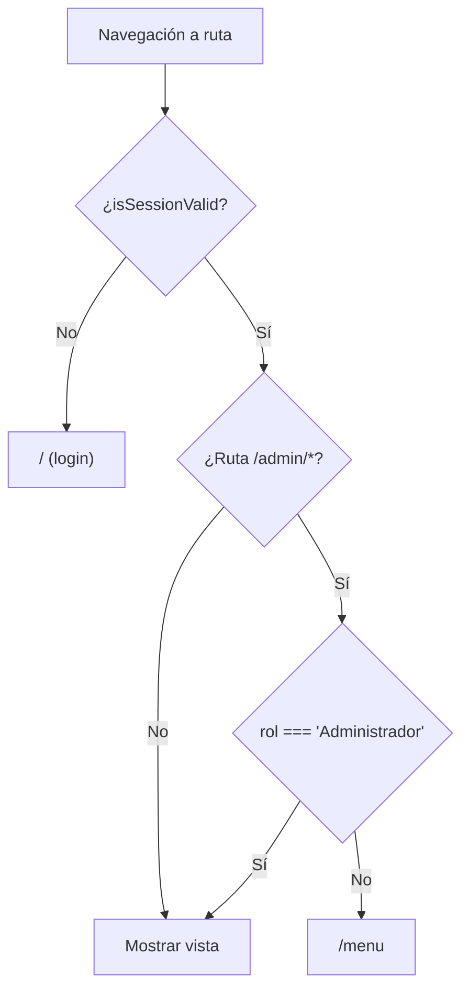
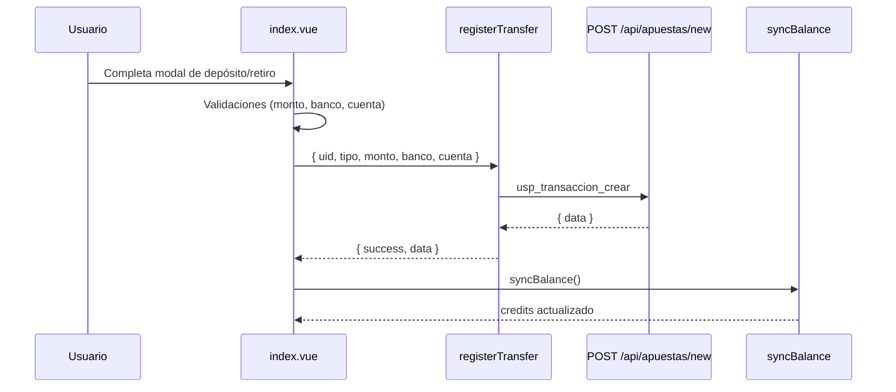

# 2. Frontend

Aplicación de una sola página (SPA) en **Vue 3 + Vite** ubicada en `front/`. Se monta en `front/src/main.js`, que importa los estilos globales (`front/css/globals.css`, `front/css/login.css`), el componente raíz `front/src/App.vue` (solo contiene `<router-view />`) y el router.

```js
// front/src/main.js
createApp(App).use(router).mount('#app')
```

Páginas relacionadas: [Visión general](01-overview.md) · [Juegos](03-juegos.md) · [Backend](04-backend.md)

## Contenido

- [Router y guards de sesión](#router-y-guards-de-sesión)
- [Store de balance](#store-de-balance)
- [Utilidades de API](#utilidades-de-api)
- [UI de autenticación](#ui-de-autenticación)
- [Menú principal, depósitos y retiros](#menú-principal-depósitos-y-retiros)
- [Panel de administración](#panel-de-administración)
- [Assets estáticos y estilos](#assets-estáticos-y-estilos)

## Router y guards de sesión

Archivo: `front/src/router/index.js`

El router usa `createWebHashHistory()`, por lo que las URLs tienen la forma `/#/menu`. Todas las vistas se importan de forma estática (sin lazy loading).

| Ruta | Componente | Guard |
|------|-----------|-------|
| `/` | `front/src/components/login.vue` | Inline: si la sesión es válida redirige a `/menu`. |
| `/menu` | `front/src/components/index.vue` | `requireAuth` |
| `/slot` | `front/src/components/games/slotM.vue` | `requireAuth` |
| `/rulete` | `front/src/components/games/rulet.vue` | `requireAuth` |
| `/BJ` | `front/src/components/games/Blackjack.vue` | `requireAuth` |
| `/plinko` | `front/src/components/games/plinko.vue` | `requireAuth` |
| `/mines` | `front/src/components/games/mines.vue` | `requireAuth` |
| `/rocket` | `front/src/components/games/rocket.vue` | `requireAuth` |
| `/admin/usuarios` | `front/src/components/admin/usuarios.vue` | `requireAdmin` |
| `/admin/juegos` | `front/src/components/admin/juegos.vue` | `requireAdmin` |
| `/admin/transaciones` | `front/src/components/admin/transaciones.vue` | `requireAdmin` |

### Guards

Los guards se aplican por ruta mediante `beforeEnter` y se apoyan en `isSessionValid()` y `getSessionInfo()` de `front/src/utils/api.js`:

```js
const requireAuth = (to, from, next) => {
  if (!isSessionValid()) next('/');
  else next();
};

const requireAdmin = (to, from, next) => {
  if (!isSessionValid()) { next('/'); return; }
  const session = getSessionInfo();
  if (!session || session.rol !== 'Administrador') next('/menu');
  else next();
};
```



> Los guards del frontend solo mejoran la experiencia de usuario; la protección real está en el backend (`SessionGuard`, `AdminGuard`, ver [Backend](04-backend.md#guards)).

## Store de balance

Archivo: `front/src/store/balance.js`

Store ligero basado en `reactive()` de Vue (no usa Pinia ni Vuex). Mantiene el estado global del usuario y lo persiste en `localStorage` bajo la clave `pb:session`.

```js
const state = reactive({
  credits: getInitialBalance(),   // saldo leído de pb:session.saldo
  uid: getSession().uid || '',
  rol: getSession().rol || 'Usuario'
});
```

| Exportación | Descripción |
|-------------|-------------|
| `balance` | `toRefs(state)`: referencias reactivas `credits`, `uid` y `rol`. Los componentes lo exponen con `setup() { return { ...balance } }`. |
| `setSession(session)` | Actualiza `uid`, `rol` y `credits` en el estado y guarda la sesión completa en `pb:session`. Se llama tras el login. |
| `updateBalance(amount)` | Suma (o resta, si es negativo) `amount` a `credits` y persiste el nuevo saldo en `pb:session`. Algunos componentes lo importan (`index.vue`, `plinko.vue`), pero actualmente ningún componente lo invoca: el saldo se actualiza siempre con `syncBalance()`. |
| `syncBalance()` | Consulta `GET https://pascualbet-cvr6.vercel.app/api/users/find/:uid` mediante `authenticatedFetch`, extrae el campo `saldo` de la respuesta y actualiza `credits` y `pb:session`. |

`syncBalance()` incluye una función interna `extractSaldo` que tolera varias formas de respuesta: número/cadena directa, objeto `{ data: ... }`, arreglo (toma el primer elemento) u objeto con una propiedad `saldo` (sin distinguir mayúsculas), buscando también un nivel de anidamiento. Si no encuentra el saldo, deja un `console.warn` sin modificar el estado.

**Patrón de uso:** la base de datos es la fuente de verdad del saldo. Tras cada apuesta (`registerBet`) o transferencia (`registerTransfer`) los componentes llaman a `syncBalance()` para reemplazar el saldo local por el real.

### Estructura de `pb:session`

Se construye en `handleLogin()` de `front/src/components/login.vue` a partir de la respuesta de `POST /api/users/login`:

```js
{
  uid,           // data.id_usuario
  nombre,        // data.nombre
  rol,           // data.rol
  saldo,         // data.saldo_actual
  dob,           // data.fecha_nacimiento
  foto,          // data.foto_perfil
  sessionToken,  // token generado por el backend
  expiresAt,     // timestamp de expiración (24 h)
  ts             // Date.now() al iniciar sesión
}
```

## Utilidades de API

### `front/src/utils/api.js`

| Función | Exportada | Descripción |
|---------|-----------|-------------|
| `getAuthHeaders()` | No | Lee `pb:session`. Si `expiresAt` ya pasó, borra la sesión y redirige a `/`. Si no, devuelve `{ 'x-user-id': uid, 'x-session-token': sessionToken }`. |
| `authenticatedFetch(url, options)` | Sí | Envoltorio de `fetch` que agrega `Content-Type: application/json` y los headers de autenticación. Si la respuesta es **401**, borra `pb:session`, redirige a `/` y lanza `Error('Sesión expirada')`. |
| `isSessionValid()` | Sí | `true` si existe `pb:session` y `Date.now() < expiresAt`. |
| `getSessionInfo()` | Sí | Devuelve el objeto de sesión parseado o `null`. |

### `front/src/utils/betApi.js`

Centraliza las peticiones de dinero al backend. Ambas funciones usan `authenticatedFetch`, lanzan un `Error` con el texto de la respuesta si `!response.ok` y esperan **200 ms** antes de devolver `{ success: true, data }` para dar tiempo a que la base de datos se actualice antes del `syncBalance()` del llamador.

#### `registerBet`

```js
registerBet({ uid, gameId, amount, result, multiplier = 1.0, netWin = 0 })
// POST https://pascualbet-cvr6.vercel.app/api/apuestas/new/bet
```

| Parámetro | Campo enviado | Descripción |
|-----------|---------------|-------------|
| `uid` | `p_id_usuario` | ID del usuario (`balance.uid`). |
| `gameId` | `p_id_juego` | Uno de los valores de `GAME_IDS`. |
| `amount` | `p_monto` | Monto apostado. |
| `result` | `p_resultado` | `'GANADA'` o `'PERDIDA'` (Blackjack también usa `'EMPATE'`). |
| `multiplier` | `p_multiplicador` | Multiplicador aplicado (por defecto `1.0`). |
| `netWin` | `p_ganancia_neta` | Ganancia neta (`premio - apuesta`). Ver nota en [Backend](04-backend.md#apuestasmodule-apuestas-y-transacciones). |

#### `registerTransfer`

```js
registerTransfer({ uid, tipo, monto, banco = '', cuenta = '', estado = 'APROBADO' })
// POST https://pascualbet-cvr6.vercel.app/api/apuestas/new
```

Envía `p_id_usuario`, `p_tipo_transaccion` (`'DEPOSITO'` o `'RETIRO'`), `p_monto`, `p_banco`, `p_cuenta_cliente` y `p_estado`.

#### `GAME_IDS`

```js
export const GAME_IDS = {
  RULETA: 1,
  SLOTS: 2,
  BLACKJACK: 3,
  PLINKO: 4,
  MINES: 5,
  ROCKET: 6
};
```

Estos IDs deben coincidir con los registros de la tabla de juegos en Supabase.

## UI de autenticación

Archivo: `front/src/components/login.vue` (Options API). Contiene dos pestañas (`activeTab`: `login` / registro) y un modal de términos y condiciones.

### Inicio de sesión — `handleLogin()`

1. Valida que ID y contraseña no estén vacíos.
2. `POST https://pascualbet-cvr6.vercel.app/api/users/login` con `{ id_usuario, contrasena }` (usa `fetch` directo, sin headers de sesión).
3. Si la respuesta es correcta, construye el objeto de sesión, llama a `setSession(session)` y `await syncBalance()`, y navega a `/menu`.
4. Los errores se muestran con el método `toast()`.

### Registro — `handleSignup()`

Validaciones del lado del cliente:

| Regla | Implementación |
|-------|----------------|
| Contraseña de 12 a 24 caracteres | `passwordRequirements[length]` |
| Sin caracteres especiales (solo `a-zA-Z0-9`) | `passwordRequirements[noSpecialChars]` |
| Al menos un número | `passwordRequirements[hasNumber]` |
| Al menos una mayúscula | `passwordRequirements[hasUppercase]` |
| Confirmación igual a la contraseña | `validateConfirmPassword()` |
| Nombre obligatorio, solo letras y espacios | `validateSignupName()` |
| Aceptar términos | `signupTerms` |
| Mayor de 18 años | función local `isAdult(dob)` |

Si todo es válido, envía `POST https://pascualbet-cvr6.vercel.app/api/users/new` con `id_usuario`, `nombre`, `contrasena`, `fecha_nacimiento` y demás datos del formulario. La contraseña se cifra en el backend con bcrypt (ver [Backend](04-backend.md#usersmodule-usuarios)).

## Menú principal, depósitos y retiros

Archivo: `front/src/components/index.vue` (Options API, ruta `/menu`).

- `setup()` expone `credits`, `uid` y `rol` del store; `mounted()` llama a `syncBalance()`.
- **Cabecera:** logo (`/img/Logo_PascualBet.jpg`; al hacer clic alterna el fondo animado con `toggleBackground()`), saldo, botones de depósito/retiro y avatar que abre el modal de cierre de sesión.
- **Catálogo de juegos:** tarjetas con portada (`/img/ruleta.png`, `/img/tragamonedas.png`, `/img/poker.png`, `/img/plinko.jpg`, `/img/mines.jpg`, `/img/rocket.jpg`) y botones que navegan con `this.$router.push()` a `/rulete`, `/slot`, `/BJ`, `/plinko`, `/mines` y `/rocket`.
- **Cierre de sesión — `logout()`:** elimina `pb:session` y hace `this.$router.replace('/')`.

### Depósitos — `confirmDeposit()`

| Validación | Valor |
|-----------|-------|
| Monto mínimo | 10 |
| Monto máximo | 10.000.000 |
| Banco | obligatorio |
| Tipo de cuenta | obligatorio si el banco es Bancolombia o Davivienda |
| Número de cuenta | exactamente 16 dígitos (los inputs eliminan caracteres no numéricos) |

### Retiros — `confirmWithdraw()`

| Validación | Valor |
|-----------|-------|
| Monto mínimo | 20 |
| Monto máximo | saldo actual (`credits`) |
| Banco / tipo de cuenta / número de cuenta | mismas reglas que el depósito |

Ambos flujos llaman a `registerTransfer({ uid, tipo: 'DEPOSITO' | 'RETIRO', monto, banco, cuenta, estado: 'APROBADO' })`, luego `await syncBalance()` y muestran un `alert` de confirmación. Los errores se muestran en `depositError` / `withdrawError`.



## Panel de administración

En `front/src/components/index.vue` existe un panel de administración (`#panel-admin`) con un botón que navega a `/admin/usuarios`.

> **Diferencia de rol:** el panel se muestra con `v-if="rol === 'ADMIN'"`, mientras que el guard `requireAdmin` del router (y `AdminGuard` del backend) comparan con `'Administrador'`. Si la base de datos devuelve `'Administrador'`, el panel del menú no se muestra, aunque las rutas `/admin/*` siguen siendo accesibles escribiendo la URL.

Las tres vistas de administración son actualmente **maquetas con datos locales**; no llaman al backend:

| Vista | Archivo | Funcionalidad actual |
|-------|---------|----------------------|
| Usuarios | `front/src/components/admin/usuarios.vue` | Tabla de usuarios de ejemplo en `data()`, filtro local, edición/eliminación/alta simuladas con `alert()`. |
| Juegos | `front/src/components/admin/juegos.vue` | Configuraciones reactivas por juego (`plinkoSettings`, `slotsSettings`, `blackjackSettings`, `minesSettings`, `rocketSettings`, `rouletteSettings`). Las funciones `save*Settings` solo hacen `console.log`. |
| Transacciones | `front/src/components/admin/transaciones.vue` | Lista de transacciones de ejemplo con filtros computados por usuario, juego, monto, resultado y fecha. |

El backend sí expone endpoints de administración (por ejemplo `GET /api/users/f`, protegido con `AdminGuard`), pero aún no están conectados a estas vistas (ver [Backend](04-backend.md#usersmodule-usuarios)).

## Assets estáticos y estilos

Los archivos de `front/public/` se sirven desde la raíz (`/img/...`, `/Sounds/...`):

| Ruta | Uso |
|------|-----|
| `front/public/img/Logo_PascualBet.jpg` | Logo de la cabecera del menú. |
| `front/public/img/fondo.png` | Fondo de la pantalla de login (`front/css/login.css`) y del menú (`front/src/components/index.vue`). |
| `front/public/img/icon.png` | Favicon (declarado en `front/index.html`). |
| `front/public/img/ruleta.png`, `tragamonedas.png`, `poker.png`, `plinko.jpg`, `mines.jpg`, `rocket.jpg` | Portadas de las tarjetas de juegos. |
| `front/public/Sounds/Slot-Machine-Jackpot-Sound-Effect.mp3` | Sonido de premio en Tragamonedas. |
| `front/public/Sounds/efecto de sonido de ruleta de juego (...).mp3` | Sonido de giro de la Ruleta. |
| `front/public/animaciones/crupier_repartiendo.gif` | Animación del crupier (no referenciada actualmente en el código). |
| `front/public/vite.svg` | Icono por defecto de la plantilla de Vite (sin uso). |
| `front/src/assets/flags/es.svg`, `gb.svg` | Banderas de idioma (sin uso actual en componentes). |

Estilos:

- `front/css/globals.css` — directivas de Tailwind, variables de tema y estilos compartidos (botones, modales, tarjetas).
- `front/css/login.css` — estilos de la pantalla de login/registro.
- `front/tailwind.config.js` — configuración de Tailwind: `content: ["./src/**/*.{html,js}"]`, fuente `pixel` ("Press Start 2P") y color `brand` (`#3ba0ff`). Nótese que el patrón `content` no incluye archivos `.vue`.
- Cada componente `.vue` define además estilos propios en su bloque `<style>`.

`front/src/js/app.js` es un script heredado que no se importa desde `main.js` ni desde ningún componente.
