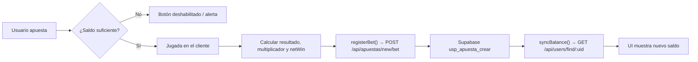

# 3. Juegos

PascualBet incluye seis juegos de casino, todos implementados como componentes Vue en `front/src/components/games/`. La lógica de cada juego (generación de resultados, cálculo de premios) se ejecuta **en el navegador**; el backend solo recibe y persiste el resultado de cada jugada mediante `registerBet`.

Páginas relacionadas: [Frontend](02-frontend.md) · [Backend](04-backend.md) · [Glosario](05-glosario.md)

## Catálogo

| Juego | Página | Componente | Ruta | `GAME_IDS` | API de Vue |
|-------|--------|-----------|------|-----------|-----------|
| Ruleta | [3.2 Ruleta](03.2-ruleta.md) | `front/src/components/games/rulet.vue` | `/rulete` | `RULETA` = 1 | Options API |
| Tragamonedas | [3.3 Tragamonedas](03.3-tragamonedas.md) | `front/src/components/games/slotM.vue` | `/slot` | `SLOTS` = 2 | Options API |
| Blackjack | [3.1 Blackjack](03.1-blackjack.md) | `front/src/components/games/Blackjack.vue` | `/BJ` | `BLACKJACK` = 3 | Options API |
| Plinko | [3.4 Plinko](03.4-plinko.md) | `front/src/components/games/plinko.vue` | `/plinko` | `PLINKO` = 4 | Composition API (`setup()`) |
| Mines | [3.5 Mines](03.5-mines.md) | `front/src/components/games/mines.vue` | `/mines` | `MINES` = 5 | `<script setup>` |
| Rocket | [3.6 Rocket](03.6-rocket.md) | `front/src/components/games/rocket.vue` | `/rocket` | `ROCKET` = 6 | `<script setup>` |

Todas las rutas están protegidas por el guard `requireAuth` (ver [Frontend → Router](02-frontend.md#router-y-guards-de-sesión)).

## Flujo común de registro de apuestas

Según `IMPLEMENTACION_COMPLETA.md` y `RESUMEN_IMPLEMENTACION.md`, todos los juegos siguen el mismo patrón:

1. Leer `uid` y `credits` del store (`front/src/store/balance.js`).
2. Validar la apuesta contra el saldo local.
3. Ejecutar la jugada en el cliente (aleatoriedad con `Math.random()`).
4. Al conocer el resultado, llamar a `registerBet()` de `front/src/utils/betApi.js`.
5. Llamar a `syncBalance()` para traer el saldo actualizado desde la base de datos.

```js
import { balance, syncBalance } from '../../store/balance.js';
import { registerBet, GAME_IDS } from '../../utils/betApi.js';

await registerBet({
  uid: uid.value,          // o this.uid en Options API
  gameId: GAME_IDS.MINES,
  amount: betAmount.value,
  result: 'GANADA',        // o 'PERDIDA'
  multiplier: 2.5,
  netWin: premio - apuesta
});
await syncBalance();
```



**Importante:**

- Ningún juego descuenta la apuesta localmente antes de jugar; el saldo solo cambia tras `syncBalance()`. Se asume que el procedimiento almacenado `usp_apuesta_crear` aplica el débito/crédito correspondiente a partir de `p_monto`, `p_resultado` y `p_multiplicador` (el SQL no forma parte del repositorio).
- El backend actualmente ignora `p_ganancia_neta` (ver [Backend](04-backend.md#apuestasmodule-apuestas-y-transacciones)).
- Los valores de `result` no están normalizados entre juegos: Plinko, Mines, Rocket y Ruleta envían `'GANADA'`/`'PERDIDA'`; Blackjack envía `'GANADO'`/`'PERDIDO'` (y `'GANADA'` en empate); Tragamonedas envía `'GANADO'`/`'PERDIDA'`. Se detalla en cada página.

## Resumen de registro por juego

| Juego | Momento del registro | `amount` | `result` | `multiplier` | `netWin` |
|-------|---------------------|----------|----------|--------------|----------|
| Blackjack | `endGame()` al terminar la mano | `betAmount` | `'GANADO'`, `'PERDIDO'`, o `'GANADA'` si hay empate | 2.5 (blackjack natural), 2 (victoria), 1 (empate), 0 (derrota) | `betAmount * multiplicador - betAmount` |
| Ruleta | `calculateWinnings()` al detenerse la rueda | `totalBet` (suma de fichas) | `'GANADA'` si `totalWin >= totalBet`, si no `'PERDIDA'` | mayor multiplicador acertado (36 o 2; 0 si ninguno) | `totalWin - totalBet` |
| Tragamonedas | `checkWin()` al detenerse los carretes | `currentBet` | `'GANADO'` o `'PERDIDA'` | valor de `paytable`, 0.5 por par o 0 | siempre `-currentBet` (ver nota en la página) |
| Plinko | `onBallFinished()` por cada bola | `betAmount` (por bola) | `'GANADA'` si el premio supera la apuesta | multiplicador de la casilla | `betAmount * multiplicador - betAmount` |
| Mines | `onTileClick()` al pisar mina / `cashout()` | `betAmount` | `'PERDIDA'` / `'GANADA'` | 0 / `currentMultiplier` | `-betAmount` / `ganancia - betAmount` |
| Rocket | `endGame()` al estrellarse / `cashOut()` | `betAmount` | `'PERDIDA'` / `'GANADA'` | 0 / multiplicador al retirar | `-betAmount` / `ganancia - betAmount` |
