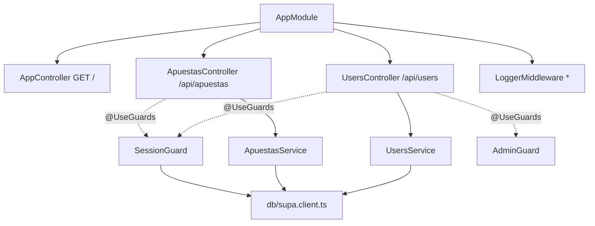
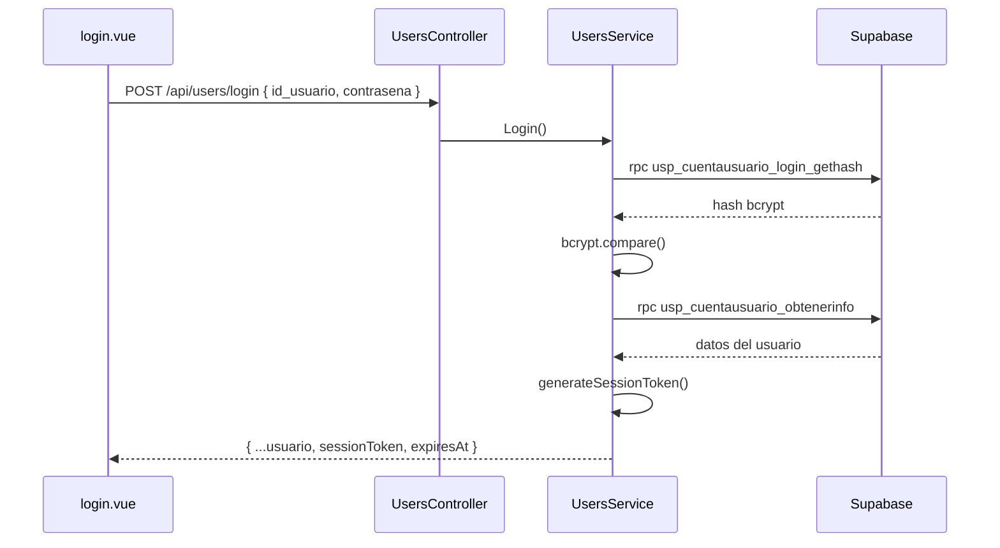

# 4. Backend

API REST en **NestJS 11** (TypeScript) ubicada en `server/`. Expone los endpoints de usuarios, apuestas y transacciones, valida sesiones y delega toda la persistencia en procedimientos almacenados de Supabase.

Páginas relacionadas: [Visión general](01-overview.md) · [Primeros pasos](01.1-getting-started.md) · [Frontend](02-frontend.md)

## Contenido

- [Arranque y módulo raíz](#arranque-y-módulo-raíz)
- [UsersModule (usuarios)](#usersmodule-usuarios)
- [Autenticación y sesiones](#autenticación-y-sesiones)
- [ApuestasModule (apuestas y transacciones)](#apuestasmodule-apuestas-y-transacciones)
- [Guards](#guards)
- [Middleware de seguridad y rate limiting](#middleware-de-seguridad-y-rate-limiting)
- [Capa de datos Supabase](#capa-de-datos-supabase)
- [Procedimientos almacenados](#procedimientos-almacenados)
- [Pruebas](#pruebas)

## Arranque y módulo raíz

### `server/src/main.ts`

```ts
const app = await NestFactory.create(AppModule);
app.use(helmet());
app.enableCors({
  origin: process.env.CORS_ORIGIN ?? '*',
  methods: 'GET,HEAD,PUT,PATCH,POST,DELETE,OPTIONS',
});
await app.listen(process.env.PORT ?? 3000);
```

### `server/src/app.module.ts`

El proyecto tiene **un único módulo Nest** (`AppModule`). Lo que esta wiki llama `UsersModule` y `ApuestasModule` son **agrupaciones funcionales** por carpeta (`server/src/users/` y `server/src/apuestas/`), no clases `@Module()` independientes: sus controladores y servicios se registran directamente en `AppModule`.

```ts
@Module({
  imports: [],
  controllers: [AppController, UsersController, ApuestasController],
  providers: [AppService, UsersService, ApuestasService],
})
export class AppModule {
  configure(consumer: MiddlewareConsumer) {
    consumer
      .apply(LoggerMiddleware)
      .forRoutes({ path: '*', method: RequestMethod.ALL });
  }
}
```

`AppController` (`server/src/app.controller.ts`) expone `GET /`, que devuelve `{ message: 'Hola' }` desde `AppService.getHello()` (`server/src/app.service.ts`).



## UsersModule (usuarios)

Archivos: `server/src/users/users.controller.ts`, `server/src/users/users.service.ts`.

### Endpoints — `@Controller('api/users')`

| Método | Ruta | Guards | Método del servicio | Procedimiento |
|--------|------|--------|---------------------|---------------|
| `POST` | `/api/users/new` | — | `create()` | `usp_cuentausuario_crear` |
| `POST` | `/api/users/login` | — | `Login()` | `usp_cuentausuario_login_gethash` + `usp_cuentausuario_obtenerinfo` |
| `GET` | `/api/users/f` | `SessionGuard`, `AdminGuard` | `findAll()` | `sp_obtenertodoslosusuarios` |
| `GET` | `/api/users/find/:p_id_usuario` | `SessionGuard` | `find()` | `usp_cuentausuario_obtenerinfo` |
| `PUT` | `/api/users/` (query: `p_id_usuario`, `p_nombre`, `p_nueva_contrasena`, `p_fecha_nacimiento`) | — | `update()` | `usp_cuentaUsuario_actualizarperfil` |
| `PUT` | `/api/users/update/user` (query: `p_id_usuario_actual`, `p_id_usuario_nuevo`) | — | `updateUsuario()` | `usp_cuentausuario_modificarid` |
| `GET` | `/api/users/bet` (query: `p_id_usuario`) | — | `apuestaUsuario()` | `sp_obtenerapuestasporusuario` |
| `GET` | `/api/users/checkPass` (query: `plain`, `hashed`) | — | `validatePassword()` | — (bcrypt) |
| `GET` | `/api/users/getHash/:p_id_usuario` | — | `getHash()` | `usp_cuentausuario_login_gethash` |

DTO de registro (`CreateUserDto`): `id_usuario`, `nombre`, `contrasena`, `fecha_nacimiento` y `rol` opcional (por defecto `'Usuario'`).

### Observaciones sobre el código actual

- `updateUsuario()` y `apuestaUsuario()` llaman a `supabase.rpc()` **sin parámetros**, por lo que los valores recibidos no llegan al procedimiento.
- `findAll()`, `find()`, `update()`, `updateUsuario()` y `apuestaUsuario()` ignoran el `error` devuelto por Supabase y responden `{ data }` (posiblemente `null`).
- `update()` envía `p_nueva_contrasena` sin cifrar con bcrypt (a diferencia de `create()`).
- Los endpoints sin guard (`PUT /`, `PUT /update/user`, `GET /bet`, `GET /checkPass`, `GET /getHash/:id`) son accesibles sin sesión; `getHash` devuelve el hash bcrypt de un usuario.

## Autenticación y sesiones

Implementado en `server/src/users/users.service.ts` (ver también `SEGURIDAD_IMPLEMENTADA.md`). No se usa Supabase Auth.

1. **Registro — `create()`:** cifra la contraseña con `bcrypt.hash(contrasena, SALT_ROUNDS)` (`SALT_ROUNDS = 10`) y llama a `usp_cuentausuario_crear` con el hash.
2. **Login — `Login(id, contrasena)`:**
   1. `getHash(id)` obtiene el hash almacenado (`usp_cuentausuario_login_gethash`) y lo normaliza a cadena, sea cual sea la forma de la respuesta (arreglo, objeto o texto).
   2. `validatePassword()` lo compara con `bcrypt.compare()`. Si no hay hash o no coincide → `401 Usuario o contraseña incorrectos.`
   3. Obtiene los datos del usuario con `usp_cuentausuario_obtenerinfo`.
   4. Genera un token con `generateSessionToken(userId)`: SHA-256 de `${userId}-${timestamp}-${randomBytes(32)}`.
   5. Responde `{ ...userInfo, sessionToken, expiresAt: Date.now() + 24h }`.



> **Limitación:** el `sessionToken` **no se almacena** en el servidor ni en la base de datos. `SessionGuard` solo comprueba que el header esté presente y que el usuario exista; no compara el token ni su expiración. La expiración de 24 h se aplica únicamente en el cliente (`front/src/utils/api.js`).

## ApuestasModule (apuestas y transacciones)

Archivos: `server/src/apuestas/apuestas.controller.ts`, `server/src/apuestas/apuestas.service.ts`.

### Endpoints — `@Controller('api/apuestas')`

| Método | Ruta | Guards | DTO | Servicio | Procedimiento |
|--------|------|--------|-----|----------|---------------|
| `POST` | `/api/apuestas/new` | `SessionGuard` | `NewTransferenceDto` | `newtrasnference()` | `usp_transaccion_crear` |
| `POST` | `/api/apuestas/new/bet` | `SessionGuard` | `NewBetDto` | `newBet()` | `usp_apuesta_crear` |

### Transacciones (depósitos y retiros)

`NewTransferenceDto`:

| Campo | Tipo | Por defecto |
|-------|------|-------------|
| `p_id_usuario` | `string` | — |
| `p_tipo_transaccion` | `string` (`'DEPOSITO'` / `'RETIRO'`) | — |
| `p_monto` | `number` | — |
| `p_banco` | `string?` | `''` |
| `p_cuenta_cliente` | `string?` | `''` |
| `p_estado` | `string?` | `'APROBADO'` |

El frontend lo invoca desde `registerTransfer()` (`front/src/utils/betApi.js`), usado por los modales de `front/src/components/index.vue`.

### Apuestas

`NewBetDto`:

| Campo | Tipo | Uso |
|-------|------|-----|
| `p_id_usuario` | `string` | Usuario que apuesta |
| `p_id_juego` | `number` | Valor de `GAME_IDS` (1–6) |
| `p_monto` | `number` | Monto apostado |
| `p_resultado` | `string` | `'GANADA'`, `'PERDIDA'` (algunos juegos envían `'GANADO'`/`'PERDIDO'`) |
| `p_multiplicador` | `number?` | Si falta, el controlador usa **2.0** |
| `p_ganancia_neta` | `number?` | Se recibe pero **no se reenvía** |

```ts
async newBets(@Body() dto: NewBetDto) {
  const { p_id_usuario, p_id_juego, p_monto, p_resultado, p_multiplicador, p_ganancia_neta } = dto;
  return this.apuestasService.newBet(
    p_id_usuario, p_id_juego, p_monto, p_resultado, p_multiplicador ?? 2.0
  );
}
```

> `p_ganancia_neta` se desestructura en el controlador, pero `ApuestasService.newBet()` no tiene ese parámetro y `usp_apuesta_crear` solo recibe `p_id_usuario`, `p_id_juego`, `p_monto`, `p_resultado` y `p_multiplicador`. El cálculo del saldo queda a cargo del procedimiento almacenado con esos datos.

Ambos métodos del servicio lanzan `Error('Supabase error: ...')` si el RPC falla (NestJS lo traduce a `500`) y devuelven `{ data }` en caso de éxito. Ninguno de los endpoints comprueba que `p_id_usuario` del cuerpo coincida con el usuario autenticado (`request.user`).

## Guards

### `SessionGuard` — `server/src/auth/session.guard.ts`

1. Lee los headers `x-user-id` y `x-session-token`. Si falta alguno → `401 Sesión no válida`.
2. Llama a `usp_cuentausuario_obtenerinfo` con `p_id_usuario = x-user-id`. Si hay error o no hay datos → `401`.
3. Adjunta el usuario a `request.user` (primer elemento si la respuesta es un arreglo) y permite la petición.

Cualquier excepción dentro del bloque `try` se re-lanza como `401 Error al validar sesión`. En el frontend, un `401` provoca el cierre de sesión automático en `authenticatedFetch()`.

### `AdminGuard` — `server/src/auth/admin.guard.ts`

Debe ejecutarse **después** de `SessionGuard` (`@UseGuards(SessionGuard, AdminGuard)`), porque depende de `request.user`. Si `request.user.rol !== 'Administrador'` lanza `403 Acceso denegado. Se requieren permisos de administrador.` Actualmente solo protege `GET /api/users/f`.

## Middleware de seguridad y rate limiting

| Mecanismo | Dónde | Estado |
|-----------|-------|--------|
| Helmet (headers HTTP de seguridad) | `server/src/main.ts` | Activo |
| CORS (`CORS_ORIGIN`, por defecto `*`) | `server/src/main.ts` | Activo |
| `LoggerMiddleware` | `server/src/common/middleware/logger.middleware.ts`, aplicado en `AppModule.configure()` a todas las rutas | Activo |
| Rate limiting (`@nestjs/throttler`) | `server/package.json` (dependencia) | **No configurado** |
| bcryptjs | `server/src/users/users.service.ts` | Activo |

**`LoggerMiddleware`** registra cada petición con el `Logger` de Nest (contexto `HTTP`) en el formato `METHOD URL STATUS - TIMEms`, escuchando los eventos `finish` y `close` de la respuesta.

> **Rate limiting:** `README.md` menciona `Throttler` como medida de seguridad y `@nestjs/throttler` está instalado, pero en `server/src/` no existe `ThrottlerModule` ni `ThrottlerGuard`. Para activarlo habría que importar `ThrottlerModule.forRoot(...)` en `AppModule` y registrar `ThrottlerGuard`. Tampoco hay `ValidationPipe`: los DTO son clases sin decoradores de validación.

## Capa de datos Supabase

Directorio: `server/src/db/` — contiene un único archivo, `supa.client.ts`:

```ts
import { createClient } from '@supabase/supabase-js'
import dotenv from 'dotenv'

dotenv.config()

const supabaseUrl = process.env.SUPABASE_URL
const supabaseKey = process.env.SUPABASE_KEY

if (!supabaseUrl || !supabaseKey) {
  throw new Error('Missing SUPABASE_URL or SUPABASE_KEY environment variables')
}

export const supabase = createClient(supabaseUrl, supabaseKey)
```

- Exporta un cliente **singleton** que importan directamente `UsersService`, `ApuestasService` y `SessionGuard` (no se usa inyección de dependencias de Nest para el cliente).
- Toda la lógica de datos vive en la base de datos: el backend nunca consulta tablas directamente, solo invoca procedimientos con `supabase.rpc(nombre, parámetros)`.
- Si faltan las variables de entorno, el error se lanza al importar el módulo, es decir, al arrancar el servidor (y también al cargar los servicios en las pruebas).

## Procedimientos almacenados

Los scripts SQL no están en el repositorio; esta es la lista de procedimientos que invoca el código y los parámetros que se les envían:

| Procedimiento | Invocado desde | Parámetros enviados | Propósito |
|---------------|----------------|---------------------|-----------|
| `usp_cuentausuario_crear` | `UsersService.create()` | `p_id_usuario`, `p_nombre`, `p_contrasena` (hash), `p_fecha_nacimiento`, `p_rol` | Crear cuenta |
| `usp_cuentausuario_login_gethash` | `UsersService.getHash()` | `p_id_usuario` | Obtener el hash bcrypt para el login |
| `usp_cuentausuario_obtenerinfo` | `UsersService.Login()`, `UsersService.find()`, `SessionGuard` | `p_id_usuario` | Datos del usuario (`id_usuario`, `nombre`, `rol`, `saldo_actual`/`saldo`, `fecha_nacimiento`, `foto_perfil`, …) |
| `usp_cuentaUsuario_actualizarperfil` | `UsersService.update()` | `p_id_usuario`, `p_nombre`, `p_nueva_contrasena`, `p_fecha_nacimiento` | Actualizar perfil |
| `usp_cuentausuario_modificarid` | `UsersService.updateUsuario()` | ninguno (ver observaciones) | Cambiar el ID de usuario |
| `sp_obtenertodoslosusuarios` | `UsersService.findAll()` | ninguno | Listar usuarios (admin) |
| `sp_obtenerapuestasporusuario` | `UsersService.apuestaUsuario()` | ninguno (ver observaciones) | Historial de apuestas de un usuario |
| `usp_transaccion_crear` | `ApuestasService.newtrasnference()` | `p_id_usuario`, `p_tipo_transaccion`, `p_monto`, `p_banco`, `p_cuenta_cliente`, `p_estado` | Registrar depósito/retiro y actualizar saldo |
| `usp_apuesta_crear` | `ApuestasService.newBet()` | `p_id_usuario`, `p_id_juego`, `p_monto`, `p_resultado`, `p_multiplicador` | Registrar apuesta y actualizar saldo |

Los campos de `usp_cuentausuario_obtenerinfo` se deducen de cómo el frontend lee la respuesta en `front/src/components/login.vue` y `front/src/store/balance.js`.

## Pruebas

Las pruebas usan **Jest 30** + **ts-jest** y, para e2e, **Supertest**.

| Tipo | Configuración | Archivos |
|------|---------------|----------|
| Unitarias (`npm run test`) | bloque `jest` de `server/package.json` (`rootDir: src`, `*.spec.ts`) | `server/src/app.controller.spec.ts`, `server/src/users/users.controller.spec.ts`, `server/src/users/users.service.spec.ts`, `server/src/apuestas/apuestas.controller.spec.ts`, `server/src/apuestas/apuestas.service.spec.ts` |
| End-to-end (`npm run test:e2e`) | `server/test/jest-e2e.json` (`testRegex: .e2e-spec.ts$`) | `server/test/app.e2e-spec.ts` |
| Cobertura (`npm run test:cov`) | salida en `server/coverage/` | — |

Estado actual de las pruebas (son las generadas por el CLI de Nest, sin adaptar al proyecto):

- Las cuatro pruebas de `users` y `apuestas` solo verifican `should be defined`. Los `*.controller.spec.ts` registran el controlador sin su servicio, por lo que la resolución de dependencias de Nest puede fallar al compilar el módulo de prueba.
- `server/src/app.controller.spec.ts` espera que `getHello()` devuelva `'Hello World!'`, y `server/test/app.e2e-spec.ts` espera `GET /` → `'Hello World!'`; el código actual devuelve `{ message: 'Hola' }` (de forma asíncrona), por lo que ambas aserciones no coinciden con la implementación.
- Todas las pruebas que cargan servicios importan `server/src/db/supa.client.ts`, que exige `SUPABASE_URL` y `SUPABASE_KEY` en el entorno.
- No hay pruebas automatizadas en el frontend; `IMPLEMENTACION_COMPLETA.md` describe un procedimiento de verificación manual con DevTools (pestaña Network).
